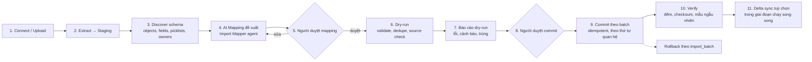

# ABCRM — Data Import từ Legacy CRM

> Yêu cầu D6: import từ **Salesforce, HubSpot, Lark Suite, Excel/CSV**.
> Mục tiêu: chuyển đổi **an toàn, kiểm chứng được, rollback được**; tenant ≤ 1M record xong trong < 1 ngày.

## 1. Quy trình chung



Toàn bộ quy trình là một **DBOS workflow** (resume được khi lỗi, theo dõi được tiến độ).

## 2. Thiết kế dữ liệu import

```sql
import_jobs(id, tenant_id, source, -- csv|xlsx|hubspot|salesforce|lark
            status, mapping_id, created_by, stats jsonb, started_at, finished_at)
import_staging_rows(job_id, source_object, source_id, raw jsonb, row_hash,
                    status, -- pending|valid|warning|error|committed|skipped
                    errors jsonb, target_type, target_id)
import_mappings(id, tenant_id, source, version, object_map jsonb, field_map jsonb,
                picklist_map jsonb, owner_map jsonb, approved_by, approved_at)
external_ids(tenant_id, system, -- salesforce|hubspot|lark
             object, external_id, internal_type, internal_id,
             UNIQUE(tenant_id, system, object, external_id))
```

- **Mọi record tạo ra mang `import_job_id`**, nên rollback được: xoá các record được tạo bởi job **và chưa bị sửa sau import**. Record đã bị sửa sau import thì đánh dấu và đưa người quyết định.
- `external_ids` giúp **re-run idempotent** (upsert thay vì tạo trùng) và hỗ trợ delta sync.
- Staging rows lưu trong cell của tenant (residency), tự xoá sau 30 ngày.

## 3. Thứ tự commit (theo quan hệ)
```
Users/Owners (map, không tạo) → Accounts/Companies → Contacts → Leads
 → Buyer hiện tại / blocklist / đối thủ (đánh dấu trên account) → Deals/Opportunities
 → Activities (email, call, note, task, meeting) → Attachments (tuỳ chọn) → Associations
```

## 4. Mapping (AI đề xuất, người duyệt)

Agent **Import Mapper** (template T11, không tính credit):
- Đề xuất **object map** (ví dụ Salesforce `Opportunity` → `deal`; HubSpot `company` → `account`).
- **Field map** kèm confidence, dựa trên tên, kiểu và mẫu dữ liệu (ví dụ `Lead_Source__c` → `lead.attribution.source`). Field không khớp thì đề xuất tạo **custom field**.
- **Picklist map**: stage của CRM cũ sang pipeline stage mới; lead status sang lifecycle status và funnel stage.
- **Owner map**: theo email user.
- **Transform**: chuẩn hoá phone (E.164), country (ISO-3166), date (timezone), currency.
- Người dùng duyệt hoặc sửa trên UI dạng bảng. Mapping được lưu và có version để dùng lại cho delta sync và job sau.

## 5. Kiểm tra trong dry-run
| Kiểm tra | Hành động |
|---|---|
| Kiểu dữ liệu, bắt buộc, độ dài | Lỗi hoặc cảnh báo theo row |
| Email/phone sai định dạng | Cảnh báo; vẫn import, đánh dấu `needs_validation` |
| Trùng trong file và với dữ liệu hiện có (blind index email/phone, domain) | Đề xuất merge / skip / tạo mới (theo chính sách người dùng chọn) |
| **Nguồn dữ liệu (provenance)** | Mỗi contact import ghi `source` (hệ thống/tệp, thời điểm) để đáp ứng yêu cầu CCPA về nguồn dữ liệu. **Contact import không tự động được liên hệ**: vẫn phải qua qualification và **G-Q** như contact do agent tìm (platform invariant) |
| **Suppression** | Import danh sách unsubscribe/bounce/DNC của hệ thống cũ **trước**, áp lên mọi contact |
| Quan hệ mồ côi (contact trỏ tới account không tồn tại) | Cảnh báo; tạo liên kết sau nếu account đến ở batch sau |

## 6. Đặc thù từng nguồn

### 6.1 Excel / CSV
- Hỗ trợ `.csv` (UTF-8, UTF-16, Windows-1252; tự nhận diện delimiter) và `.xlsx` nhiều sheet (mỗi sheet một object).
- Parse dạng streaming cho file lớn; giới hạn mặc định 1M dòng/file.
- Template mẫu tải về cho từng object.

### 6.2 HubSpot
- Xác thực: OAuth app (public app) với scope read của CRM objects.
- Discover: Properties API để lấy schema (gồm custom properties), Pipelines API cho stage, Owners API.
- Extract: CRM objects (companies, contacts, deals, tickets), engagements (emails, calls, notes, meetings, tasks), **associations** giữa các object; phân trang theo cursor; tuân thủ rate limit (tự điều tiết với backoff khi gặp 429).
- Delta: lọc theo `lastmodifieddate` hoặc webhook subscription trong giai đoạn chạy song song.

### 6.3 Salesforce
- Xác thực: OAuth (Connected App / External Client App), refresh token.
- Discover: `describeGlobal` và `describe` từng object (gồm custom objects `__c`, picklist values, record types).
- Extract: **Bulk API 2.0** cho object lớn (Account, Contact, Lead, Opportunity, Task, Event, Campaign, CampaignMember); REST cho metadata và object nhỏ; ContentDocument/Attachment (tuỳ chọn).
- Lưu ý: giới hạn API theo edition (tính và hiển thị dự kiến số call trước khi chạy); Lead đã convert (`IsConverted`) map về contact và deal tương ứng; OpportunityContactRole sang deal–contact role.
- Delta: `SystemModstamp`.

### 6.4 Lark Suite
- Phân biệt **Lark (quốc tế, larksuite.com)** và **Feishu (Trung Quốc)**, hai endpoint khác nhau. Hỗ trợ Lark quốc tế trước.
- Dữ liệu CRM trên Lark thường nằm trong **Lark Base (Bitable)**: dùng Open API để liệt kê app, table, field và record (phân trang). Xác thực bằng app credentials (tenant access token) và quyền mà người dùng cấp cho app trên Base.
- Field type của Base (single/multi select, user, link to another table, attachment, formula) phải map riêng; **link fields** sang associations.
- Nếu khách dùng Lark CRM chuyên biệt hoặc ứng dụng bên thứ ba trên Lark: đánh giá theo từng trường hợp, có thể dùng **export Excel** làm phương án dự phòng.
- ❓ Cần lấy 1–2 Base mẫu từ design partner để kiểm chứng (nhiều agency châu Á dùng Lark để quản lý danh sách buyer).

### 6.5 Công cụ outbound (Instantly, Smartlead, lemlist…)
- MVP: import **CSV export** của các công cụ này: danh sách campaign lead, trạng thái (contacted, replied, bounced, unsubscribed), blocklist.
- **Mục tiêu chính là an toàn**: mọi unsubscribe, bounce và "not interested" từ công cụ cũ được đưa vào **suppression trước khi** import prospect, để không gửi lại cho người đã từ chối.
- Sau MVP: import qua API của từng công cụ (theo công cụ design partners dùng nhiều nhất).

## 7. Delta sync & cutover
1. Import đầy đủ (full import).
2. Chạy song song 1–4 tuần (**không** gửi email từ cả hai hệ thống cho cùng một prospect; khoá prospect theo hệ thống đang sở hữu): delta sync **một chiều** (legacy sang ABCRM) theo lịch hoặc webhook; xung đột thì ưu tiên bản sửa trong ABCRM (cấu hình được).
3. Cutover: tắt delta sync, khoá import, đổi webhook lead source sang Ingest API của ABCRM.
4. Báo cáo cuối: số lượng theo object, record lỗi, record thiếu nguồn dữ liệu.

## 8. Hiệu năng & giới hạn
- Commit theo batch 1.000–5.000 rows/transaction, `COPY` vào staging, upsert theo `external_ids`.
- Đánh index sau khi bulk load lớn (khi tenant mới, chưa có dữ liệu).
- Tiến độ realtime trên UI; có thể pause/resume.
- Ước lượng: 1M record ≈ 1–3 giờ (nút thắt thường là rate limit API của nguồn, không phải ABCRM).

## 9. Bảo mật
- OAuth token của hệ thống nguồn mã hoá bằng KMS, **xoá sau khi kết thúc import/delta sync**.
- Chỉ role `owner`/`admin` được chạy import; mọi job có audit.
- File upload quét malware, lưu trong bucket của cell, tự xoá sau 30 ngày.
